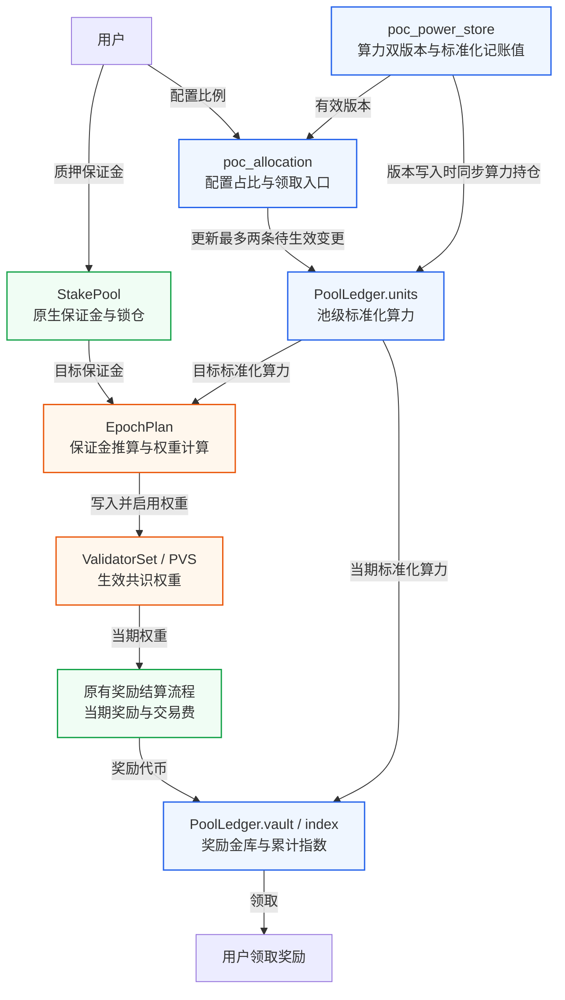
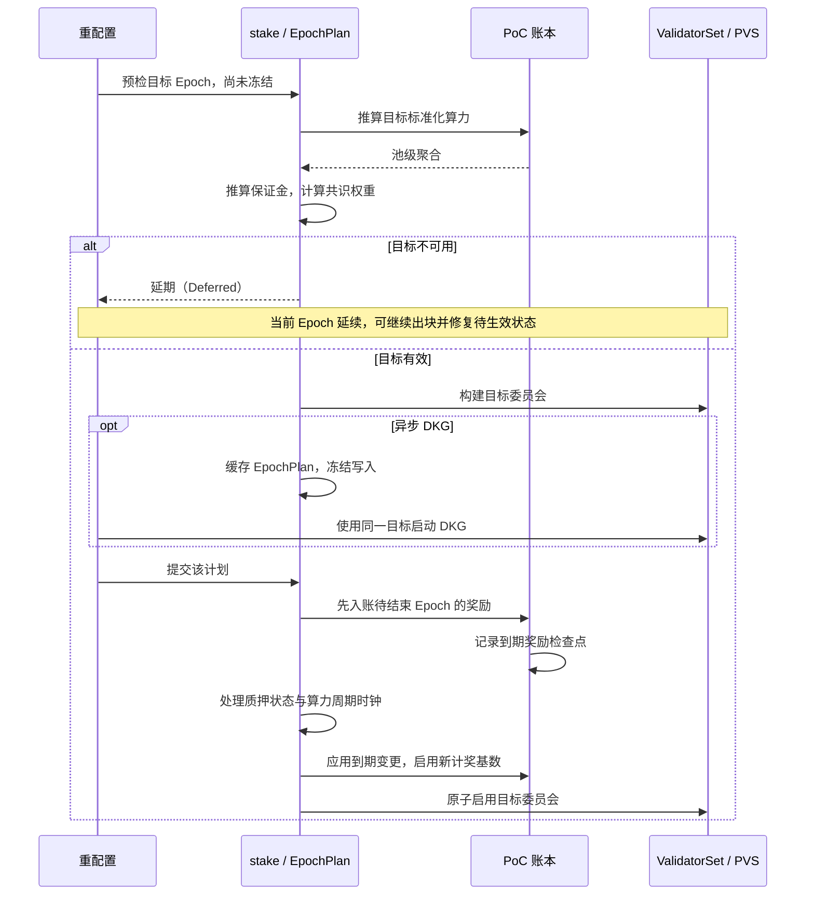

# PoC 共识 v2：算力权重与奖励最小实现方案

> 状态：设计草案 / MVP（最小可行版本）
>
> 范围：BFT 共识权重、验证者通胀奖励和池内用户奖励；交易费沿用原有归属规则。
>
> 核心方案：原生质押机制管理保证金本金与锁仓，PoC 管理算力分配与奖励。每次 Epoch 切换时，根据池内算力和保证金确定委员会权重；该 Epoch 的奖励也按这份生效算力结算。

## 术语约定

正文保留 PoC、BFT、MVP 等通用缩写。Epoch 表示共识纪元，保留英文以便对照源码；DKG 表示分布式密钥生成，PVS 表示预计算验证者集合（`PrecomputedValidatorSet`）。模块名、类型名、字段名和函数名使用代码格式，保留原名。

| 英文概念 | 正文用语 | 含义 |
| --- | --- | --- |
| Native | 原生质押机制 | Aptos 原有的质押、锁仓与奖励流程 |
| pool / validator pool | 质押池，简称池 | 验证者对应的底层质押池，以 `StakePool` 地址标识；不专指委托池 `DelegationPool` |
| allocation | 算力分配 | 用户配置分配给各池的算力比例 |
| power period / period | 算力周期 | 包含多个 Epoch 的算力更新与衰减周期 |
| units | 标准化算力单位 | 消除共同衰减因子后的记账单位；正文简称标准化算力，字段名为 `units` |
| position | 算力持仓 | 用户在某个池中的算力分配及奖励记录 |
| vault | 奖励金库 | 池账本中保存奖励代币的字段，不是额外资源 |
| checkpoint | 奖励检查点 | 记录持仓变更生效时的累计奖励指数 |
| shares | 质押份额 | 原生质押机制中的本金与收益份额，与标准化算力单位不同 |

状态名称按对象区分：算力分配配置使用“已生效 / 待生效”，验证者成员状态使用“在任 / 待加入 / 待退出”。涉及保证金余额时保留 `active`、`pending_active`、`pending_inactive`、`inactive` 等字段名，避免混淆不同层级的状态。

## 1. 设计约束

用户先向验证者质押池存入保证金，再配置分配给各池的算力比例。保证金在池内共享，协议只校验整个池的担保能力；不将算力与用户个人保证金逐一绑定，也不为各类原生质押路径增加用户关系表。

- 以 `poc_power_store` 保存的双版本原始算力为输入；贡献值计算、上报与审核不在本文范围内。
- 算力分配比例以基点（bps）表示，`10_000` 基点为 `100%`。每份配置中的池地址必须唯一，各项 `bps > 0`，总和不超过 `10_000`。已生效与待生效目标池的并集不超过 `MAX_ALLOCATIONS`；从配置中移除某个池，即取消对该池的分配。
- 只允许向已注册、已启用 PoC 的池分配算力。MVP 不限制池可接收的分配算力总量（pool allocation cap）；保证金能够支撑的生效算力仍有上限，因此新增分配可能摊薄池内单位算力收益。
- 原生质押池所有者（owner）与普通用户采用相同的算力分配和奖励规则；只提供保证金、没有算力的用户不获得 PoC 协议奖励。
- MVP 中，验证者运营者的 PoC 奖励佣金（operator commission）为 `0`；奖励单独领取，领取后可通过原生质押入口再次质押。
- Aptos 链上治理继续按原生代币质押权重运行。本文的“投票权重”仅指 BFT 共识权重。

算力分配与原始算力更新采用不同的生效时点：

| 变化 | 生效时间 | 当期是否变化 |
| --- | --- | --- |
| 算力分配比例 | 下一 Epoch | 否 |
| 双版本原始算力 | 下一算力周期的首个 Epoch | 否 |
| 担保比例、PoC 权重门槛 | 参数指定的下一 Epoch | 否 |
| 原生质押保证金 | 沿用原有待处理状态与锁仓规则，计算目标 Epoch 的可用余额 | 当期 BFT 权重不变 |
| 统一算力衰减 | 算力周期切换时 | 算力周期内不变 |

当前源码默认一个算力周期包含 `60` 个 Epoch。MVP 保留这一节奏：每个算力持仓、每个池最多保存两条待生效变更，分别对应下一 Epoch 和下一算力周期的首个 Epoch；生效 Epoch 相同的变更合并为一条。

## 2. 架构与职责



图中的 `units`、`vault` 和 `index` 是同一 `PoolLedger` 的不同字段。底层账本 `poc_accounting` 保存算力分配配置、算力持仓、池级聚合数据和奖励资产；`poc_allocation` 提供用户入口，不重复保存这些状态。奖励金库就是池账本中的 `Coin<TopoCoin>` 字段，无需新增独立的金库资源。

调用依赖保持单向：

```text
poc_allocation -> stake / poc_power_store / poc_accounting
stake         -> poc_power_store / poc_accounting
poc_power_store -> poc_accounting
poc_accounting  -> 不依赖以上三个模块
```

只有可信框架入口能修改底层账本。`poc_power_store` 传入原始算力版本及其生效时间，`stake` 传入 Epoch、保证金与奖励。账本不反向查询 `poc_power_store`、`stake` 或 `reconfiguration`；冻结检查通过 `reconfiguration_state` 的底层只读入口完成，按需增加 `friend` 授权，避免循环依赖。

## 3. 权重与奖励

### 3.1 算力使用统一的标准化单位

`raw_power` 表示 `poc_power_store` 中的用户原始算力；`units` 是消除共同衰减因子后的标准化算力记账值；`power` 是写入 `ValidatorSet` 并生效的整数共识权重。

设 `I[p]` 为算力周期 `p` 的共同衰减指数；`UNIT_SCALE`、`INDEX_SCALE`、`POWER_SCALE` 为固定协议常量：

```text
I[0] = INDEX_SCALE
I[p+1] = floor(I[p] * retention_bps / 10_000)

version_units = floor(raw_power * UNIT_SCALE * INDEX_SCALE / I[effective_period])
position_units = floor(version_units * allocation_bps / 10_000)

pool_power = floor(sum(position_units) * I[target_period]
                   / (UNIT_SCALE * INDEX_SCALE))
```

`PowerVersion` 写入时缓存派生的标准化算力 `units`，同时保留原始算力 `power` 及其生效周期 `effective_period`。`PeriodClock` 保存当前和下一算力周期的衰减指数；版本与指数绑定后不再重算，因此读取旧版本无需查询完整的历史指数表。

当前 `poc_power_store::apply_retention` 对每个用户按算力周期逐次取整，与先汇总全池算力、再取整的结果不等价。PoC 共识与奖励统一使用上述标准化算力记账值；原有整数查询接口可供旧模式使用，但不能参与 PoC 聚合。用户界面展示的整数算力之和也不要求等于池权重。

MVP 固定每周期算力保留比例 `retention_bps`，防止已经排定的未来标准化算力被追溯改写。算力周期长度的变更只影响下一周期的持续时长，不能移动已经确定的下一次切换时点。实现时须证明：在支持的运行期限内，始终满足 `I[p] > 0`，`u128` 标准化算力记账值与 `u256` 运算中间值均不溢出。不能假定有限精度的指数可以无限期使用。

### 3.2 保证金限制池的总生效算力

`bond_per_power` 表示每 `POWER_SCALE` 单位原始算力所需的保证金数量，以代币最小单位计量，且必须大于 `0`：

```text
bond = active + pending_active + unexpired pending_inactive
bond_cap = floor(bond * POWER_SCALE / bond_per_power)
candidate = min(pool_power, bond_cap, max_power)
```

`bond` 是按原生质押状态推算的目标 Epoch 可用保证金。已转为 `inactive` 的余额、在本次截止时间 `cutoff_secs` 已到期的 `pending_inactive` 余额，以及奖励金库中尚未复投的奖励，均不计入。同步重配置与 DKG 使用一致的截止时间规则。

候选验证者必须同时满足：已注册并启用 PoC、原有验证者配置有效、处于在任或待加入状态、达到原生质押的最低额度，且 `candidate >= min_power`。待退出的验证者仍参与当前 Epoch 的共识，但不参与下一届选举。

原生质押额度沿用现有入口校验：申请加入验证者集合时检查最低和最高额度，追加质押时检查最高额度。Epoch 切换时不因超过最高质押额度而淘汰验证者；PoC 的 `max_power` 也只限制生效权重上限。

允许增加的权重总量称为增长预算。其比例沿用原有 `voting_power_increase_limit`，计算时使用 PoC 算力单位：

```text
base[i] = 当前已安装 PoC 权重，新加入者为 0
delta[i] = max(candidate[i] - base[i], 0)
budget = floor(current_total_power * increase_limit / 100)
growth = sum(delta[i])

若 growth <= budget：power[i] = candidate[i]
否则：
  power[i] = min(candidate[i], base[i])
             + floor(delta[i] * budget / growth)
```

计算结果低于 `min_power` 的候选验证者不入选。剔除候选后剩余的增长预算，以及取整产生的预算余量，均不再分配，因此只需线性扫描，无需按余数或地址排序。委员会沿用原有的确定性候选顺序和验证者索引编排。参数必须满足 `min_power > 0`、`min_power <= max_power`，且 `min_validators` 不得超过原有验证者数量上限。

只有创世或明确指定的首次 PoC 启用流程可以直接初始化权重，不比较不同单位下的权重增长。正常 PoC 运行中，即使总权重为零，也不能自动触发这一例外。

### 3.3 同一生效权重决定收益

```text
ValidatorInfo.voting_power = power
reward_base = floor(power * bond_per_power / POWER_SCALE)

inflation = native_reward_formula(reward_base, epoch_rate, validator_performance)
pool_reward = inflation + native_distributable_fee
```

计奖基数 `reward_base` 随共识权重一起确定，并在该 Epoch 内保持不变；结算时仍使用这一基数，不读取下一 Epoch 的新担保参数。通胀奖励继续按原有奖励率和出块表现计算，不设置固定总额的全网奖励池。

池内用户的理论生效算力和奖励占比为：

```text
user_effective_power = power * user_units / pool_units
user_reward_share = user_units / pool_units
```

共同衰减、保证金约束导致的算力折减，以及权重增长限制，都对同池用户按相同比例生效，因此无需存储或逐用户取整 `user_effective_power`。例如，两名用户的标准化算力之比为 `60 : 40`，池的最终生效权重为 `50`，则两人的理论生效算力分别为 `30` 和 `20`；该池获得 `10` 单位奖励时，两人分别分得 `6` 和 `4`。

交易费沿用原有的验证者归属规则、功能开关和每池限额，再按池内各用户生效的标准化算力分配。不同池的奖励还取决于出块表现和交易费收入，因此每单位生效算力的收益可能不同。

## 4. 最小状态与命名

以下结构展示需要保存的状态，省略存储容器初始化及接口语法细节：

```move
struct PowerParams has copy, drop, store {
    bond_per_power: u64,
    min_power: u64,
    max_power: u64,
    min_validators: u64,
}

// 放在用户地址；active / pending 的元素都是 pool + bps。
struct UserAllocation has key {
    active: vector<PoolRatio>,
    pending: Option<AllocationChange>,
    positions: Table<address, Position>,
}

struct PoolRatio has copy, drop, store { pool: address, bps: u64 }
struct AllocationChange has store { epoch: u64, ratios: vector<PoolRatio> }

struct Position has store {
    units: u128,
    changes: vector<PositionChange>,
    cursor: u256,
    accrued: u256,
}

struct PositionChange has copy, drop, store { epoch: u64, units: u128 }

struct PoolChange has store {
    epoch: u64,
    remove_units: u128,
    add_units: u128,
    refs: u64,
}

struct Checkpoint has store { index: u256, refs: u64 }

// 放在框架地址下的 Table<pool_address, PoolLedger>。
struct PoolLedger has store {
    epoch: u64,
    units: u128,
    changes: vector<PoolChange>,
    reward_base: u64,
    reward_epoch: u64,
    index: u256,
    checkpoints: Table<u64, Checkpoint>,
    vault: Coin<TopoCoin>,
}
```

| 状态 | 保留理由 |
| --- | --- |
| `UserAllocation.active / pending` | 保存已生效与待生效的分配配置，供原始算力更新时重建分配；比例从指定 Epoch 起逻辑生效，在后续相关写操作时写回 `active` |
| `Position.units / changes` | 保存历史计奖所需的标准化算力及最多两条尚未结算的变更；旧原始算力版本从存储中移除后仍可领奖 |
| `PoolLedger.units / changes` | 保存池内当前标准化算力总量，以及按生效 Epoch 分组的增减记录；用户操作只修改相关池 |
| `PoolChange.remove_units / add_units` | 用无符号整数分别记录扣减量与增加量，按先减后加计算净变化，无需引入有符号算力类型 |
| `Checkpoint.index / refs` | 保存持仓变更生效时的累计奖励指数；最后一个引用结算后删除检查点 |
| `Position.cursor / accrued` | 防止重复结算，累计未领取奖励，并保留不足一个代币最小单位的余量；`accrued` 按“代币最小单位 × 奖励精度”记账 |
| `PoolLedger.reward_base / reward_epoch` | 固定当期计奖基数，防止同一 Epoch 重复入账 |
| `PoolLedger.vault` | 保存实际奖励代币，独立于原生质押份额记账 |

框架地址下的全局账本还保存链的绝对 Epoch 编号 `epoch`。上层在初始化时将它与链上编号对齐，此后每次成功提交 Epoch 变更时同步更新；算力存储模块和用户入口据此安排生效时间。`PeriodClock.last_epoch` 只是局部提交次数，不能直接当作链上的 Epoch 编号；`B` 由绝对 Epoch 编号与算力周期剩余计数推导。

全局 PoC 配置保存当前参数，以及可选的待生效参数和生效时间 `activation_epoch`。首次启用 PoC 的 Epoch 由这份配置唯一确定，不为每个池增加独立模式开关。

生效权重 `power` 以 `ValidatorSet` 或 PVS 为唯一依据，`PoolLedger` 不重复保存；是否入选（`selected`）由权重是否非零推导。创建池账本即表示允许接收 PoC 算力分配。验证者运营者必须通过原有退出接口离开委员会；MVP 保留池账本，以便用户领取历史奖励。

`MAX_ALLOCATIONS` 限制已生效配置、待生效配置和尚未生效变更涉及的池的并集大小。已退出持仓的历史领奖记录可以保留，但不参与后续原始算力同步。每次领取操作须明确指定目标池，数量受限。

## 5. 用户与原始算力更新

令当前 Epoch 为 `E`，当前算力周期为 `P`，下一算力周期的首个 Epoch 为 `B`。待生效变更只能安排在 `E+1` 或 `B`；两者相同时只保留一条最终状态。

一次算力分配或原始算力更新须在同一事务中完成以下步骤：

1. 将相关池的账本推进到当前 Epoch `E`，结算算力持仓中已到生效时间的变更及奖励，并将已生效的分配配置写回 `active`。
2. 根据持仓原有的标准化算力变更记录，逐项撤销尚未生效的池级增减记录，并扣减对应引用数。
3. 根据当前与未来的原始算力版本，以及已生效与待生效的分配比例，重新计算 `E+1`、`B` 两个时点的最终标准化算力。
4. 合并生效 Epoch 相同的变更，省略标准化算力没有变化的记录。每条记录以上一段的标准化算力为起点，重新累计 `remove_units`、`add_units` 和 `refs`。
5. 写回持仓、分配配置与原始算力版本。任一步骤失败，整笔事务回滚；重配置冻结期间拒绝这些写入。

例如，忽略衰减，用户当前原始算力为 `100`，已上链的下一算力周期原始算力为 `200`。用户在当前算力周期中途，将分配给某个池的比例从 `50%` 改为 `25%`：

| 生效时间 | 用户在该池的标准化算力 | 对池总量的变更 |
| --- | --- | --- |
| 当前 Epoch | 50 | 无 |
| `E+1` | 25 | 扣减 50，增加 25 |
| `B` | 50 | 扣减 25，增加 50 |

修改分配比例时，必须同时重建 `B` 对应的变更。若只修改 `E+1`，未来原始算力仍会按旧比例分配；若直接在 `E+1` 使用新原始算力，又会使它提前生效。

原始算力仍通过既有入口写入，同时必须在同一事务中同步账本：仅当算力存储模块实际新增版本时，重建该用户 `K` 个相关池的变更记录。重复上报不重复计账。双版本数据通过这次同步接入共识，不能依赖后台遍历用户，也不能只发送事件后等待用户手动刷新。

用户操作或原始算力写入前，先处理已经到生效时间的变更，因此每个持仓和池各自尚未处理的变更最多两条。池中可以保留多个历史奖励检查点，其数量取决于尚未结算的持仓变更，不会在每个 Epoch 无条件增加。

## 6. Epoch 预检与提交

每次重配置统一使用一份仅在本次流程中有效的提交计划：

```move
struct PoolTarget has copy, drop, store {
    pool: address,
    units: u128,
    power: u64,
    reward_base: u64,
}

struct EpochPlan has key {
    epoch: u64,
    period: u64,
    cutoff_secs: u64,
    params: PowerParams,
    targets: vector<PoolTarget>,
}
```

`epoch` 是目标 Epoch 编号。`targets` 包含当前参与共识的池与下一届候选池的并集；未入选池的 `power` 和 `reward_base` 均为 `0`。沿用原有确定性顺序，无需对全部池地址排序。

同步重配置在预检后立即提交计划；DKG 路径在同一事务中缓存计划与 PVS，并冻结所有影响结果的写入。计划与 PVS 只能由框架成对生成、提交后成对移除；读取缓存时必须确认其目标为当前 Epoch 的下一 Epoch。无需另存含义不明确或需要遍历用户才能计算的 `state_hash`；计划中的非零权重、验证者配置与 PVS 必须来自同一次构建。



预检必须在调用 `on_reconfig_start`、结算奖励和处理原生质押待处理状态之前完成。DKG 完成路径也须先确认冻结计划有效，再清理会话并应用缓冲配置。目标参数取自将要生效的配置；待结束的 Epoch 仍按其适用的模式和参数结算奖励。

目标委员会人数不足、总权重为零等可预期的业务失败返回延期结果 `Deferred`。此时不修改委员会、算力周期时钟、参数或待生效状态，不结算奖励，并继续允许修复状态的交易。区块前置处理（block prologue）不能因此中止；普通治理事务若要求配置变更立即触发重配置，则应在提交配置前拒绝不满足条件的事务。PoC 模式不得单独套用原生质押中按代币权重重算的空集合回退逻辑。

计划有效时，按以下顺序提交：

1. 使用待结束 Epoch 的标准化算力、计奖基数与验证者索引，结算奖励和原有规则允许分发的交易费，每池只入账一次。
2. 为已到生效时间的 `PoolChange` 写入奖励检查点，初始引用数取该记录的 `refs`。
3. 执行原有资产状态转换。每次成功提交 Epoch 变更时，推进一次 `PeriodClock` 倒计时；只有到达算力周期边界时才切换周期编号及衰减指数。同时启用已到生效时间的 PoC 参数。
4. 各池执行 `units = units - remove_units + add_units`，只删除本次已处理的变更，保留未来算力周期的变更。
5. 写入并启用计划中的计奖基数和验证者集合（`ValidatorSet` / PVS）；退出或被剔除池的计奖基数归零。全局投票总权重等于所有入选验证者权重之和。

重配置期间，冻结算力分配、原始算力版本、担保配置、候选成员及其他影响计划的写入。MVP 不增加第三条未来变更记录，也不将冻结期间的修改顺延至再下一个 Epoch。奖励领取只结算已生效状态，可以继续执行。

正常 DKG、Chunky DKG、超时强制结束和治理强制结束流程，都使用同一份已冻结计划，不能在完成阶段重新选择验证者集合。如果支持取消重配置，必须同时丢弃计划与 PVS 并解除冻结，不能只提交其中一份。

不随每次 Epoch 切换遍历已退出的池。再次操作这些池时，先处理最多两条已到生效时间的变更。退出期间累计奖励指数不增长，奖励检查点记录这一不变的指数即可。

## 7. 累计奖励指数

设某池在 Epoch `E` 获得 `R` 个代币最小单位的奖励，`U` 为该 Epoch 的生效标准化算力总量，`Q` 为固定奖励精度：

```text
delta_index = floor(R * Q / U)
pool.index += delta_index
```

MVP 在每个 Epoch 独立取整，不向下一 Epoch 结转池级除法余数。取整后未分配的奖励保留在金库中，既不计入后续奖励指数，也不提供单独提取入口。因此，即使用户等量换仓、池的标准化算力总量不变，新用户也不会分得上一批用户留下的奖励余量。

用户结算时，按已到生效时间的持仓变更逐段计算：

```text
对每条已成熟变化：
    accrued += units * (checkpoint.index - cursor)
    units = change.units
    cursor = checkpoint.index
    checkpoint.refs -= 1

accrued += units * (pool.index - cursor)
cursor = pool.index

仅在 claim 时：
    claimable = floor(accrued / Q)
    accrued %= Q
```

只有领取奖励时才支付并扣除 `claimable`；普通更新保留完整的累计奖励 `accrued`。检查点的引用数归零后即可删除。即使池级算力增减相互抵消、总量不变，只要有用户的标准化算力发生变化，就必须创建奖励检查点。

`U == 0` 时跳过除法，并要求该期生效权重、通胀奖励和可分发交易费均为 `0`。奖励金库余额必须覆盖所有用户的可领取奖励。每期因池级取整而未分配的奖励小于 `U / Q` 个代币最小单位，因此须根据池内标准化算力总量的上限选择足够大的 `Q`。

## 8. 对原有代码的最小改动

| 位置 | 必要修改 |
| --- | --- |
| `poc_power_store` | 增加派生标准化算力与衰减指数读取；新增版本时在同一事务中同步相关持仓；检查冻结状态；禁止 PoC 模式追溯修改算力保留比例 |
| `poc_accounting` / `poc_allocation` | 新增变更记录、奖励账本和用户入口，管理所有用户级 PoC 状态 |
| `reconfiguration` / `reconfiguration_with_dkg` | 在状态修改前预检，不满足条件时延期；统一同步重配置、DKG 和强制结束流程的计划生命周期 |
| `stake` 的委员会构建逻辑 | 使用 PoC 生效权重；保留原有权重数据结构、Rust `EpochState` 格式及共识法定权重阈值（quorum）算法 |
| `stake::update_stake_pool` | 使用待结束 Epoch 已固定的计奖基数，奖励代币存入 PoC 金库；交易费保留功能开关、每池限额及按旧索引结算、按新索引重建记录的流程 |
| 追加质押、申请加入、取消待加入申请 | 停止按代币数量更新 `total_joining_power`；PoC 增长预算由目标委员会构建逻辑统一计算 |
| `join_validator_set` | 保留原有质押额度及验证者配置检查；PoC 待加入验证者的临时权重为 `0`，目标委员会生效时写入最终值 |
| `delegation_pool::get_add_stake_fee` | PoC 奖励不再增加原生质押份额价值，因此返回 `0` |
| 查询与事件 | 保留原有治理权重查询；新增共识权重与 PoC 奖励查询，事件中明确奖励归属 |

重新激活质押、解锁和提取（`reactivate` / `unlock` / `withdraw`）无需增加用户算力更新钩子。这些操作对保证金的影响，由目标委员会构建逻辑统一读取。直接质押、质押合约（`StakingContract`）、委托池（`DelegationPool`）和归属合约（`Vesting`）继续按原有方式记录本金所有权；原有佣金接口不处理新增 PoC 奖励。

首次启用 PoC 时，先按原生质押模式结算最后一期奖励，再启用首个 PoC 委员会。首份计划只计入预检时已有的保证金，不计入尚未结算的末期原生质押奖励与交易费；后者仍存入 `StakePool`，从下一次构建目标委员会起计入保证金，避免 DKG 等待期间的出块表现改变首份计划。历史质押份额及其中已有收益继续按原有所有权领取，不迁入 PoC 奖励金库，也不要求所有用户提前领取。首次切换时不比较 PoC 算力权重与原有代币权重的增长率。

源码核对入口：[双版本与周期时钟](../../aptos-move/framework/topo-framework/sources/poc/poc_power_store.move)、[原生质押与奖励](../../aptos-move/framework/topo-framework/sources/stake.move)、[重配置与 DKG](../../aptos-move/framework/topo-framework/sources/reconfiguration_with_dkg.move)、[委托池](../../aptos-move/framework/topo-framework/sources/delegation_pool.move)、[治理权重](../../aptos-move/framework/topo-framework/sources/topo_governance.move)。

## 9. 不变量与验收

```text
sum(active bps) <= 10_000，sum(pending bps) <= 10_000
推进后 pool.units == 所有 position 的逻辑生效 units 之和
position / pool changes 数量 <= 2
pool.index 单调不减，reward_epoch 每次入账严格递增
当前 BFT 权重只来自已安装 ValidatorSet
reward_base 对应同一已安装 Epoch 的 power 与担保比例
累计 claim <= 累计入账；vault = 累计入账 - 累计 claim
```

| 操作 | 增量复杂度 |
| --- | --- |
| Epoch 预检与提交 | `O(V)`，`V` 为当前投票池与候选池数量；不遍历所有注册池 |
| 原始算力更新 | `O(K)`，`K <= MAX_ALLOCATIONS` |
| 替换算力分配配置 | 更新旧、新目标集合的并集，最多涉及 `2 * MAX_ALLOCATIONS` 个池 |
| 单个算力持仓结算 | 最多处理两条已到生效时间的变更 |
| 用户聚合 | 在变更交易中增量完成，无 Epoch `O(U)` 扫描 |

这里的 `O(V)` 仅指新增的 PoC 计算，原有质押流程的查找成本仍然存在。

必须覆盖的验收场景：

1. 算力周期中途，先上传下一周期原始算力再修改分配配置，或按相反顺序操作，最终得到相同目标状态。
2. `E+1 == B` 时合并为一条；多次覆盖、取消、原始版本重复上报不重复计账。
3. 用户长期不操作、池长期退出或旧原始算力版本被移除后，仍能依据历史奖励检查点准确领奖。
4. 两名用户等量换仓，池的标准化算力总量不变，历史收益仍归原用户。
5. 保证金不足、生效权重达到上限或权重增长受限时，池内所有用户按相同比例折减，奖励分配比例保持一致。
6. 同步重配置、DKG 和超时结束流程构建并启用相同计划，旧验证者索引对应的交易费记录只结算一次。
7. 目标委员会不可用时，继续出块并接受修复交易，不提交部分状态；池退出后计奖基数归零。
8. 首次启用时不混用代币与算力单位，同一笔奖励不能通过原生质押份额和 PoC 奖励领取接口重复领取。
9. 验证衰减指数精度、标准化算力聚合、奖励金库余额及最长支持运行期限的数值上界，确保区块前置处理不会因这些计算溢出。
