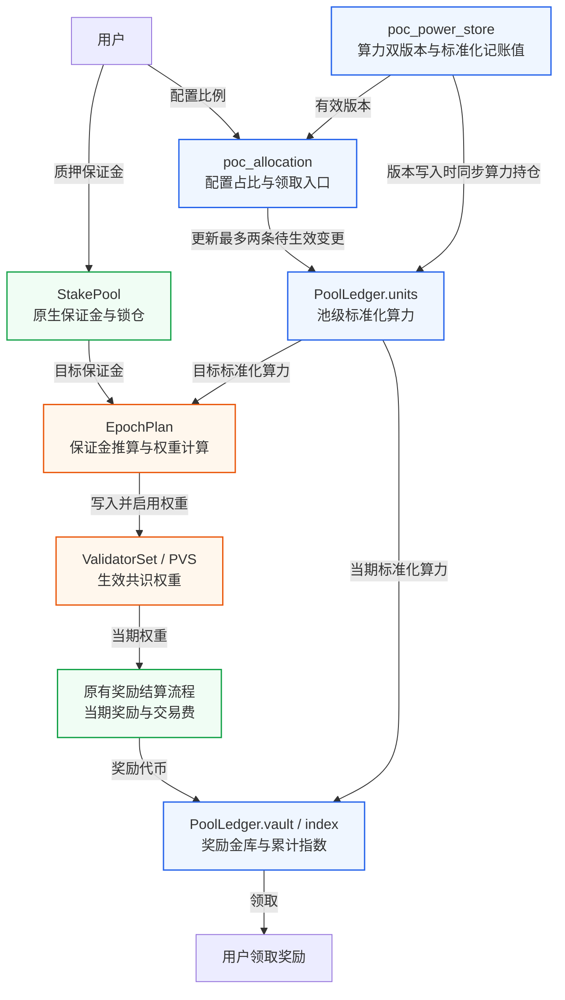
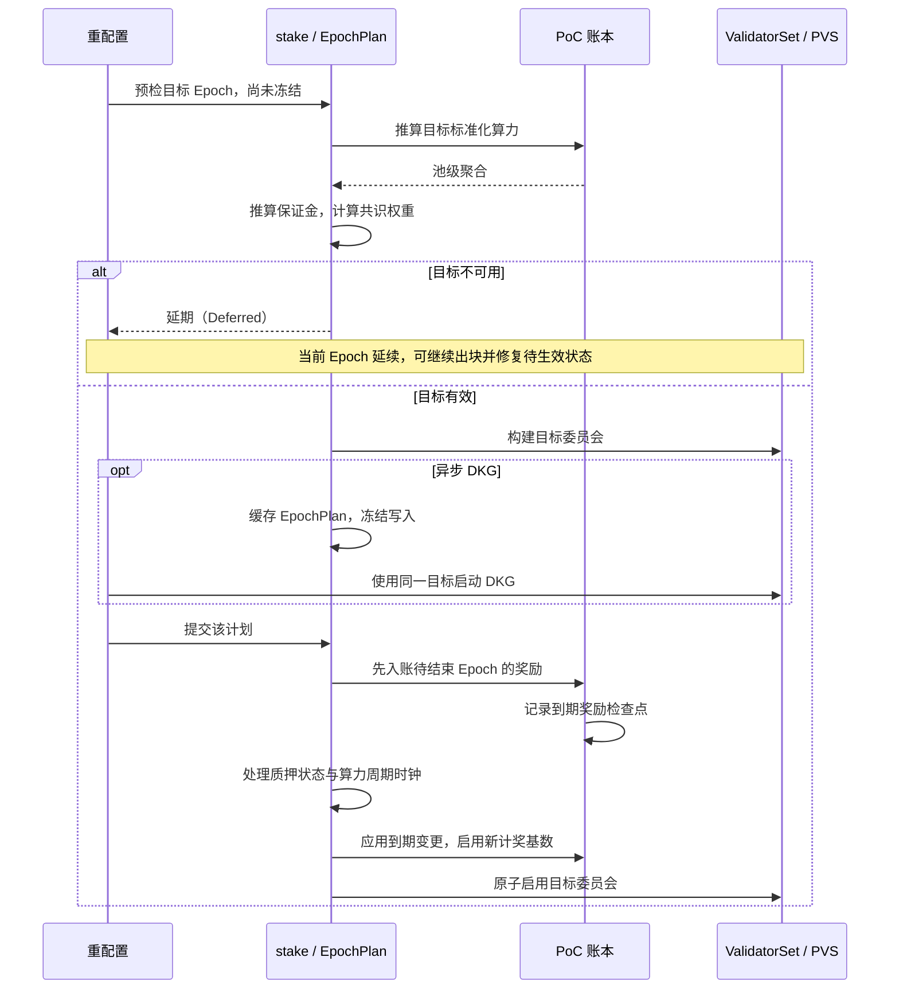

# PoC 共识 v2：算力权重与奖励最小实现方案

> 状态：设计草案 / MVP（最小可行版本）
>
> 范围：BFT 共识权重、验证者通胀奖励和池内用户奖励；交易费沿用原有归属规则。
>
> 核心方案：原生质押机制管理保证金本金与锁仓，PoC 管理算力分配与奖励。每次 Epoch 切换时，根据池内算力和保证金确定委员会权重；该 Epoch 的奖励也按这份生效算力结算。

## 修订说明（2026-09-08）

本次按 MVP 范围补齐换届恢复、数值边界、重配置冻结和首次启用规则，保留标准化算力、最多两条变更、奖励检查点及单份 `EpochPlan` 的架构。

| 修订项 | 本次调整 |
| --- | --- |
| 换届可恢复性 | 增加增长预算与最低权重的参数约束、主动退出预检和取消待退出规则；明确多候选竞争时的修复方式 |
| 数值边界 | 给出固定记账精度、池级容量及 DKG 总权重限制；要求部署前核定衰减期限与奖励金库容量 |
| 重配置与计奖 | 列出冻结入口，区分无计划预检与冻结计划提交；固定旧 Epoch 的计奖上下文 |
| 首次启用 | 明确最后一期原生奖励、入池费、预启用状态及已有链资源迁移 |
| 部署前提 | 区分受控白名单试验网与开放网络；明确共享保证金不要求算力用户逐一出资，运营成本由参与方承担 |

本次源码核对基线为 `b520f3ebb9`。该基线包含原生质押、重配置和 DKG 实现，但没有 `poc_power_store.move`。本文中的双版本、周期时钟和 `60` Epoch 默认周期属于待接入的设计约定；实现前须补齐对应模块及版本，不将其表述为已经核实的现有行为。第 3.4 节中的技术常量也是本次设计取值。

MVP 继续采用池级共享保证金、零 PoC 运营佣金、奖励余数不结转的规则；不增加个人保证金关系表、第三条未来变更、全用户扫描或 `state_hash`。无限期指数重基准和复杂换届平滑机制留待后续版本；开放网络的最低安全约束与已有链的兼容迁移仍须分别满足第 3.5、8.2 节的要求。

## 术语约定

正文保留 PoC、BFT、MVP 等通用缩写。Epoch 表示共识纪元，保留英文以便对照源码；DKG 表示分布式密钥生成，PVS 表示预计算验证者集合（`PrecomputedValidatorSet`）。模块名、类型名、字段名和函数名使用代码格式，保留原名。

| 英文概念 | 正文用语 | 含义 |
| --- | --- | --- |
| Native | 原生质押机制 | Aptos 原有的质押、锁仓与奖励流程 |
| pool / validator pool | 质押池，简称池 | 验证者对应的底层质押池，以 `StakePool` 地址标识；不专指委托池 `DelegationPool` |
| allocation | 算力分配 | 用户配置分配给各池的算力比例 |
| power period / period | 算力周期 | 包含多个 Epoch 的算力更新与衰减周期 |
| units | 标准化算力单位 | 消除共同衰减因子后的记账单位；正文简称标准化算力，字段名为 `units` |
| position | 算力持仓 | 用户在某个池中的算力分配及奖励记录 |
| vault | 奖励金库 | 池账本中保存奖励代币的字段，不是额外资源 |
| checkpoint | 奖励检查点 | 记录持仓变更生效时的累计奖励指数 |
| shares | 质押份额 | 原生质押机制中的本金与收益份额，与标准化算力单位不同 |

状态名称按对象区分：算力分配配置使用“已生效 / 待生效”，验证者成员状态使用“在任 / 待加入 / 待退出”。涉及保证金余额时保留 `active`、`pending_active`、`pending_inactive`、`inactive` 等字段名，避免混淆不同层级的状态。

## 1. 设计约束

保证金提供者通过原生质押入口向验证者质押池存入保证金，算力用户配置分配给各池的算力比例；两者可以是不同账户。保证金在池内共享，协议只校验整个池的担保能力，不要求每个算力用户先为目标池出资，也不将算力与用户个人保证金逐一绑定。各类原生质押路径无需新增用户关系表。

- 以 `poc_power_store` 保存的双版本原始算力为输入；贡献值计算、上报与审核不在本文范围内。
- 算力分配比例以基点（bps）表示，`10_000` 基点为 `100%`。每份配置中的池地址必须唯一，各项 `bps > 0`，总和不超过 `10_000`。已生效与待生效目标池的并集不超过 `MAX_ALLOCATIONS`；从配置中移除某个池，即取消对该池的分配。
- 只允许向已注册、已启用 PoC 的池分配算力。MVP 不设置业务层面的池算力接收上限（pool allocation cap），但必须满足第 3.4 节的记账容量上限；保证金能够支撑的生效算力仍有上限，因此新增分配可能摊薄池内单位算力收益。
- 原生质押池所有者（owner）与普通用户采用相同的算力分配和奖励规则；只提供保证金、没有算力的用户不获得 PoC 协议奖励。
- MVP 中，验证者运营者的 PoC 奖励佣金（operator commission）为 `0`；奖励单独领取，领取后可通过原生质押入口再次质押。
- 保证金和节点运营成本由参与方自有资金或约定的外部补贴承担。该 MVP 不保证保证金提供者或运营者获得足以覆盖成本的协议收入；开放市场中的持续运营激励需另行设计。
- Aptos 链上治理继续按原生代币质押权重运行。本文的“投票权重”仅指 BFT 共识权重。

算力分配与原始算力更新采用不同的生效时点：

| 变化 | 生效时间 | 当期是否变化 |
| --- | --- | --- |
| 算力分配比例 | 下一 Epoch | 否 |
| 双版本原始算力 | 下一算力周期的首个 Epoch | 否 |
| 担保比例、PoC 权重门槛 | 参数指定的下一 Epoch | 否 |
| 原生质押保证金 | 沿用原有待处理状态与锁仓规则，计算目标 Epoch 的可用余额 | 当期 BFT 权重不变 |
| 统一算力衰减 | 算力周期切换时 | 算力周期内不变 |

MVP 约定默认一个算力周期包含 `60` 个 Epoch，实际实现须与接入的周期时钟核对。每个算力持仓、每个池最多保存两条待生效变更，分别对应下一 Epoch 和下一算力周期的首个 Epoch；生效 Epoch 相同的变更合并为一条。

## 2. 架构与职责



图中的 `units`、`vault` 和 `index` 是同一 `PoolLedger` 的不同字段。底层账本 `poc_accounting` 保存算力分配配置、算力持仓、池级聚合数据和奖励资产；`poc_allocation` 提供用户入口，不重复保存这些状态。奖励金库就是池账本中的 `Coin<TopoCoin>` 字段，无需新增独立的金库资源。

调用依赖保持单向：

```text
poc_allocation -> stake / poc_power_store / poc_accounting
stake         -> poc_power_store / poc_accounting
poc_power_store -> poc_accounting
poc_accounting  -> 不依赖以上三个模块
```

只有可信框架入口能修改底层账本。`poc_power_store` 传入原始算力版本及其生效时间，`stake` 传入 Epoch、保证金与奖励。账本不反向查询 `poc_power_store`、`stake` 或 `reconfiguration`；冻结检查通过 `reconfiguration_state` 的底层只读入口完成，按需增加 `friend` 授权，避免循环依赖。

## 3. 权重与奖励

### 3.1 算力使用统一的标准化单位

`raw_power` 表示 `poc_power_store` 中的用户原始算力；`units` 是消除共同衰减因子后的标准化算力记账值；`power` 是写入 `ValidatorSet` 并生效的整数共识权重。

设 `I[p]` 为算力周期 `p` 的共同衰减指数；`UNIT_SCALE`、`INDEX_SCALE`、`POWER_SCALE` 为固定协议常量：

```text
I[0] = INDEX_SCALE
I[p+1] = floor(I[p] * retention_bps / 10_000)

version_units = floor(raw_power * UNIT_SCALE * INDEX_SCALE / I[effective_period])
position_units = floor(version_units * allocation_bps / 10_000)

pool_power = floor(sum(position_units) * I[target_period]
                   / (UNIT_SCALE * INDEX_SCALE))
```

`PowerVersion` 的逻辑记录保存派生标准化算力 `units`、原始算力 `power` 及其生效周期 `effective_period`。新部署可直接采用该结构；已有链须按第 8.2 节使用兼容存储，不能直接修改已发布普通结构的字段布局。`PeriodClock` 保存当前和下一算力周期的衰减指数；版本与指数绑定后不再重算，因此读取旧版本无需查询完整的历史指数表。

逐用户、逐算力周期取整的衰减，与先汇总全池算力、再取整的结果不等价。PoC 共识与奖励统一使用上述标准化算力记账值；接入模块的旧整数查询接口可供旧模式使用，但不能参与 PoC 聚合。用户界面展示的整数算力之和也不要求等于池权重。

MVP 接受向下取整带来的整数门槛效应。即使新版本刚生效、`allocation_bps = 10_000`，两次除法也可能使 `raw_power = 100` 对应 `pool_power = 99`；增大精度常量不能保证消除这一现象。最低权重判断始终使用计算完成后的整数 `power`，不能用界面展示值或未取整的理论值替代。

MVP 在部署时确定 `retention_bps`，要求 `0 < retention_bps <= 10_000`，自建立标准化基线起固定不变，包括首次启用前的准备阶段。算力周期长度的变更只影响下一周期的持续时长，不能移动已经确定的下一次切换时点。第 3.4 节规定支持期限与数值上界；部署前必须证明该期限内指数、记账值和运算中间值均有效，并安排到期前升级。

### 3.2 保证金限制池的总生效算力

`bond_per_power` 表示每 `POWER_SCALE` 单位原始算力所需的保证金数量，以代币最小单位计量，且必须大于 `0`：

```text
bond = active + pending_active + unexpired pending_inactive
bond_cap = floor(bond * POWER_SCALE / bond_per_power)
candidate = min(pool_power, bond_cap, max_power)
```

`bond` 是按原生质押状态推算的目标 Epoch 可用保证金。已转为 `inactive` 的余额、在本次截止时间 `cutoff_secs` 已到期的 `pending_inactive` 余额，以及奖励金库中尚未复投的奖励，均不计入。同步重配置与 DKG 使用一致的截止时间规则。

候选验证者必须同时满足：已注册并启用 PoC、原有验证者配置有效、处于在任或待加入状态、达到原生质押的最低额度，且 `candidate >= min_power`。待退出的验证者仍参与当前 Epoch 的共识，但不参与下一届选举。

原生质押额度沿用现有入口校验：申请加入验证者集合时检查最低和最高额度，追加质押时检查最高额度。Epoch 切换时不因超过最高质押额度而淘汰验证者；PoC 的 `max_power` 也只限制生效权重上限。

允许增加的权重总量称为增长预算。其比例沿用原有 `voting_power_increase_limit`，计算时使用 PoC 算力单位：

```text
base[i] = 当前已安装 PoC 权重，新加入者为 0
delta[i] = max(candidate[i] - base[i], 0)
budget = floor(current_total_power * increase_limit / 100)
growth = sum(delta[i])

若 growth <= budget：power[i] = candidate[i]
否则：
  power[i] = min(candidate[i], base[i])
             + floor(delta[i] * budget / growth)
```

计算结果低于 `min_power` 的候选验证者不入选。剔除候选后剩余的增长预算，以及取整产生的预算余量，均不再分配，因此只需线性扫描，无需按余数或地址排序。委员会沿用原有的确定性候选顺序和验证者索引编排，入选数量不得超过 `MAX_VALIDATOR_SET_SIZE`。参数必须满足 `min_power > 0`、`min_power <= max_power`、`1 <= min_validators <= MAX_VALIDATOR_SET_SIZE`，以及原生 `0 < increase_limit <= 50` 的限制。

支持动态成员替换的配置还必须满足以下组合约束，按宽整数计算：

```text
floor(min_validators * min_power * increase_limit / 100) >= min_power
```

该约束保证：在委员会恰好达到最低人数和最低权重、没有其他候选竞争增长预算时，预算至少能容纳一个达到最低权重的替补。设置或更新相关参数时须联合校验，不能只检查每个字段的范围。受控单节点试验配置可关闭动态成员变更，但不能将其视为已经支持正常成员替换。

例如，`min_validators = 4`、`min_power = 10`、`increase_limit = 20` 时，最低总权重为 `40`，预算仅为 `8`，该动态替换配置应被拒绝。增长比例改为 `25` 后，在其他节点权重不增长、仅一个合格替补的条件下，新节点可获得 `10` 的权重并完成替换。

该组合约束不保证多个候选能同时加入。MVP 保留一次比例分配规则；候选相互摊薄到门槛以下时，须通过取消待加入申请或分批申请修复。未入选的新候选不积累临时权重，成功换届后沿用原生行为转为不在任状态，再次参选须重新申请。主动退出须按第 6.2 节预检，并提供取消待退出的路径，避免把正常成员替换永久留在 `Deferred`。

只有创世或明确指定的首次 PoC 启用流程可以直接初始化权重，不比较不同单位下的权重增长。正常 PoC 运行中，即使总权重为零，也不能自动触发这一例外。

### 3.3 同一生效权重决定收益

```text
ValidatorInfo.voting_power = power
reward_base = floor(power * bond_per_power / POWER_SCALE)

inflation = native_reward_formula(reward_base, epoch_rate, validator_performance)
pool_reward = inflation + native_distributable_fee
```

计奖基数 `reward_base` 随共识权重一起确定，并在该 Epoch 内保持不变；结算时仍使用这一基数，不读取下一 Epoch 的新担保参数。通胀奖励继续按原有奖励公式和出块表现计算，不设置固定总额的全网奖励池。

`stake` 在每次安装 Epoch 时保存一份全局 `RewardContext`，固定该期的计奖模式、奖励率、交易费分发开关与每池费用限额。计划准备和提交均使用待结束 Epoch 的这份上下文；与奖励有关的治理修改只影响下一 Epoch。原生奖励率的周期性下降仍在旧期奖励结算后计算，再写入新期上下文。上下文不包含出块计数或实际费用余额，后两者在 DKG 等待期间继续累计，提交时按旧验证者索引读取。

池内用户的理论生效算力和奖励占比为：

```text
user_effective_power = power * user_units / pool_units
user_reward_share = user_units / pool_units
```

共同衰减、保证金约束导致的算力折减，以及权重增长限制，都对同池用户按相同比例生效，因此无需存储或逐用户取整 `user_effective_power`。例如，两名用户的标准化算力之比为 `60 : 40`，池的最终生效权重为 `50`，则两人的理论生效算力分别为 `30` 和 `20`；该池获得 `10` 单位奖励时，两人分别分得 `6` 和 `4`。

交易费沿用原有的验证者归属规则、功能开关和每池限额，再按池内各用户生效的标准化算力分配。不同池的奖励还取决于出块表现和交易费收入，因此每单位生效算力的收益可能不同。

### 3.4 数值规约与支持期限

本版采用以下固定技术常量；指数以 `u128` 保存，涉及乘法、除法和限幅的中间计算使用 `u256`：

| 常量 | 取值 | 用途 |
| --- | --- | --- |
| `UNIT_SCALE` | `2^32` | 标准化算力精度 |
| `INDEX_SCALE` | `2^64` | 初始衰减指数 |
| `MIN_PERIOD_INDEX` | `2^40` | 支持期限内允许使用的最小指数 |
| `MAX_RAW_POWER` | `2^64 - 1` | 单个原始算力版本的硬上限 |
| `MAX_POOL_UNITS` | `2^120` | 池级当前与每个待生效时点的标准化算力上限 |
| `Q` | `2^128` | 奖励精度，以 `u256` 表示 |
| `MAX_TOTAL_POWER` | `2^64 - 1` | 目标委员会总权重上限 |

`POWER_SCALE` 为部署时确定的正 `u64` 常量，启用后不可修改。`retention_bps`、担保参数、奖励率上限、交易费限额和支持期限属于部署参数，必须在部署清单中给出具体值并通过以下校验；示例值不能自动作为生产配置。

1. 以 PoC 标准化基线的周期 `0` 为起点，选定有限的支持周期上限 `P_MAX`，逐次验证该范围内的 `I[p]`，保证当前和任何已排定版本的生效指数均不小于 `MIN_PERIOD_INDEX`。例如保留比例为 `99%` 时，本组常量允许的最大有效周期为 `1655`；`p = 1656` 已低于下限。保留比例为 `100%` 时指数不衰减，但仍须按部署期限及源周期编号的 `u64` 容量确定有限的 `P_MAX`。这些是周期数，不能在未确定 Epoch 时长和周期长度时直接换算为运行年限。
2. 在该范围内，`MAX_RAW_POWER * UNIT_SCALE * INDEX_SCALE / MIN_PERIOD_INDEX < 2^120`，单版本可由 `u128` 表示。每次修改算力或分配配置，都须在同一事务中校验相关池当前、`E+1`、`B` 的聚合值及增减记录，确保均不超过 `MAX_POOL_UNITS`，引用计数不超过 `u64`。失败时回滚用户写入，不能仅依赖 Epoch 提交时的算术异常。
3. 先用宽整数计算 `bond`、`pool_power`、`bond_cap` 并应用 `max_power`，再转换为最终 `u64` 权重。目标委员会须满足 `0 < sum(power) <= MAX_TOTAL_POWER`。现有 DKG 和 Chunky DKG 共用的舍入代码使用 `u64` 求和；只限制单池权重或只验证 Move 的 `u128` 总和不够。MVP 同时采用保守的配置约束 `MAX_VALIDATOR_SET_SIZE * max_power <= MAX_TOTAL_POWER`，使合法候选组合不会因总权重过大而阻塞换届；仍保留计划中的实际总和检查。
4. 部署清单须固定允许的 `reward_base` 上限 `B_MAX`、奖励率上限 `rate_max`、启用费用分发时的限额上限 `fee_max`，以及从首次 PoC Epoch 起最多结算的 Epoch 数 `H`。要求 `floor(max_power * bond_per_power / POWER_SCALE) <= B_MAX <= u64::MAX`，并按最优出块表现计算 `R_MAX = floor(B_MAX * rate_max) + fee_max`，满足 `H > 0`、`H * R_MAX <= u64::MAX`、`first_poc_epoch + H <= u64::MAX`；首次启用前用拟启用 Epoch 校验最后一个条件。参数更新也必须保持这些上限；不能使用默认无限额的费用配置替代验证。
5. PoC 金库初始余额为零，不接受用户直接捐款或额外注资。上一项因此覆盖整个支持期限内用户从不领取的情况，保证 `Coin<TopoCoin>` 的 `u64` 余额不会溢出。每池累计入账乘 `Q` 小于 `2^192`；结合正确的持仓分段和池级聚合不变量，可界定奖励指数与用户累计权益，不能把互不相关的最大值直接相乘来替代证明。奖励公式的中间运算也须使用宽整数，覆盖长期延期时仍在增长的出块统计。

`P_MAX` 从标准化基线周期 `0` 累计，`H` 从首次 PoC Epoch 累计；准备阶段经过的算力周期也消耗指数期限。修改周期长度、延期首次启用、重配置重试或更新参数不能重置指数；已启用后也不能重置奖励期限。部署须约定预警阈值并在到达任一上限前完成升级；到期保护不能替代升级计划，也不承诺到期后继续换届。MVP 不实现自动重基准或临时改精度。首次启用检查、参数校验和验收报告必须包含部署清单及边界计算结果。

### 3.5 部署范围与委员会安全前提

受控白名单试验网可以依靠已声明的验证者信任与运营安排验证本方案；此时须明确故障假设，不以最低节点人数宣称开放网络安全。开放网络的每个 Epoch 仍要求恶意节点控制的总权重小于全网权重的三分之一，保留原有 quorum 算法不能自动证明这一前提。

开放部署的 MVP 至少在预检中增加单池集中度约束 `3 * power[i] < sum(power)`，不满足时按第 6.2 节延期并保留修复入口。该约束使用最终限幅后的权重和总和，乘法使用宽整数；它要求至少四个入选池，只限制单池影响力，不能识别同一实体控制多个池或替代对恶意权重总量的假设。部署方式须在启用前确定，开放部署不能因预检失败而临时关闭此检查。

必须验证算力迁移的反例：当前五池权重均为 `20`，四池算力迁到四个新池，增长预算为 `20`，最终可能得到 `[20, 5, 5, 5, 5]`。原来占比 `20%` 的池升至 `50%`，即使人数和最低权重合格，开放部署也必须拒绝该目标。MVP 通过预检和撤回操作修复此类状态；更复杂的总权重下降限制、迁移平滑与候选调度留待后续版本。

## 4. 最小状态与命名

以下结构展示需要保存的状态，省略存储容器初始化及接口语法细节：

```move
struct PowerParams has copy, drop, store {
    bond_per_power: u64,
    min_power: u64,
    max_power: u64,
    min_validators: u64,
}

// 放在用户地址；active / pending 的元素都是 pool + bps。
struct UserAllocation has key {
    active: vector<PoolRatio>,
    pending: Option<AllocationChange>,
    positions: Table<address, Position>,
}

struct PoolRatio has copy, drop, store { pool: address, bps: u64 }
struct AllocationChange has store { epoch: u64, ratios: vector<PoolRatio> }

struct Position has store {
    units: u128,
    changes: vector<PositionChange>,
    cursor: u256,
    accrued: u256,
}

struct PositionChange has copy, drop, store { epoch: u64, units: u128 }

struct PoolChange has store {
    epoch: u64,
    remove_units: u128,
    add_units: u128,
    refs: u64,
}

struct Checkpoint has store { index: u256, refs: u64 }

// 放在框架地址下的 Table<pool_address, PoolLedger>。
struct PoolLedger has store {
    epoch: u64,
    units: u128,
    changes: vector<PoolChange>,
    reward_base: u64,
    reward_epoch: u64,
    index: u256,
    checkpoints: Table<u64, Checkpoint>,
    vault: Coin<TopoCoin>,
}
```

| 状态 | 保留理由 |
| --- | --- |
| `UserAllocation.active / pending` | 保存已生效与待生效的分配配置，供原始算力更新时重建分配；比例从指定 Epoch 起逻辑生效，在后续相关写操作时写回 `active` |
| `Position.units / changes` | 保存历史计奖所需的标准化算力及最多两条尚未结算的变更；旧原始算力版本从存储中移除后仍可领奖 |
| `PoolLedger.units / changes` | 保存池内当前标准化算力总量，以及按生效 Epoch 分组的增减记录；用户操作只修改相关池 |
| `PoolChange.remove_units / add_units` | 用无符号整数分别记录扣减量与增加量，按先减后加计算净变化，无需引入有符号算力类型 |
| `Checkpoint.index / refs` | 保存持仓变更生效时的累计奖励指数；最后一个引用结算后删除检查点 |
| `Position.cursor / accrued` | 防止重复结算，累计未领取奖励，并保留不足一个代币最小单位的余量；`accrued` 按“代币最小单位 × 奖励精度”记账 |
| `PoolLedger.reward_base / reward_epoch` | `reward_base` 固定当期计奖基数；`reward_epoch` 记录最后已入账的 Epoch，安装新基数时不能提前把新 Epoch 标记为已结算 |
| `PoolLedger.vault` | 保存实际奖励代币，独立于原生质押份额记账 |

框架地址下的全局账本还保存链的绝对 Epoch 编号 `epoch`。上层在初始化时将它与链上编号对齐，此后每次成功提交 Epoch 变更时同步更新；算力存储模块和用户入口据此安排生效时间。接入时须核实 `PeriodClock.last_epoch` 的语义，局部提交次数不能直接当作链上的 Epoch 编号；`B` 由绝对 Epoch 编号与算力周期剩余计数推导。周期时钟还须固定标准化基线对应的源周期编号，使指数的相对周期 `p` 与原始版本的生效周期之间有唯一映射，不能在首次启用延期后重新归零。

全局 PoC 配置保存当前参数，以及可选的待生效参数和生效时间 `activation_epoch`。首次成功启用时写定 `first_poc_epoch`，此后计算奖励期限 `H` 均使用该值，不能被后续参数的生效时间覆盖。配置还记录启用前确定的部署方式，开放部署不能在运行中关闭集中度检查；不为每个池增加独立模式开关。

`stake` 另保存当前 Epoch 的一份全局 `RewardContext`，不为每个池重复保存奖励率和费用开关。为区分自主退出与治理移除，还需保存按池地址索引的自主退出申请 Epoch 标记，其数量受当前委员会规模限制。取消申请或完成换届时清除标记；治理移除必须清除同池的自主退出标记，包括该池已经处于待退出队列的情况。

当前生效权重 `power` 只以已安装的 `ValidatorSet` 为依据，PVS 仅代表被冻结的目标委员会；`PoolLedger` 不重复保存权重。是否入选（`selected`）由对应委员会中的权重是否非零推导。创建池账本即表示允许接收 PoC 算力分配。运营者主动退出使用原有退出入口，未通过资格检查的池则按选举规则剔除；MVP 保留池账本，以便用户领取历史奖励。

`MAX_ALLOCATIONS` 限制已生效配置、待生效配置和尚未生效变更涉及的池的并集大小。已退出持仓的历史领奖记录可以保留，但不参与后续原始算力同步。每次领取操作须明确指定目标池，数量受限。

## 5. 用户与原始算力更新

令当前 Epoch 为 `E`，当前算力周期为 `P`，下一算力周期的首个 Epoch 为 `B`。待生效变更只能安排在 `E+1` 或 `B`；两者相同时只保留一条最终状态。

一次算力分配或原始算力更新须在同一事务中完成以下步骤：

1. 将相关池的账本推进到当前 Epoch `E`，结算算力持仓中已到生效时间的变更及奖励，并将已生效的分配配置写回 `active`。
2. 根据持仓原有的标准化算力变更记录，逐项撤销尚未生效的池级增减记录，并扣减对应引用数。
3. 根据当前与未来的原始算力版本，以及已生效与待生效的分配比例，重新计算 `E+1`、`B` 两个时点的最终标准化算力。
4. 合并生效 Epoch 相同的变更，省略标准化算力没有变化的记录。每条记录以上一段的标准化算力为起点，重新累计 `remove_units`、`add_units` 和 `refs`。
5. 写回持仓、分配配置与原始算力版本。任一步骤失败，整笔事务回滚；重配置冻结期间拒绝这些写入。

例如，忽略衰减，用户当前原始算力为 `100`，已上链的下一算力周期原始算力为 `200`。用户在当前算力周期中途，将分配给某个池的比例从 `50%` 改为 `25%`：

| 生效时间 | 用户在该池的标准化算力 | 对池总量的变更 |
| --- | --- | --- |
| 当前 Epoch | 50 | 无 |
| `E+1` | 25 | 扣减 50，增加 25 |
| `B` | 50 | 扣减 25，增加 50 |

修改分配比例时，必须同时重建 `B` 对应的变更。若只修改 `E+1`，未来原始算力仍会按旧比例分配；若直接在 `E+1` 使用新原始算力，又会使它提前生效。

原始算力通过接入模块的授权入口写入，同时必须在同一事务中同步账本：仅当算力存储模块实际新增版本时，重建该用户 `K` 个相关池的变更记录。重复上报不重复计账。双版本数据通过这次同步接入共识，不能依赖后台遍历用户，也不能只发送事件后等待用户手动刷新。

用户操作或原始算力写入前，先处理已经到生效时间的变更，因此每个持仓和池各自尚未处理的变更最多两条。池中可以保留多个历史奖励检查点，其数量取决于尚未结算的持仓变更，不会在每个 Epoch 无条件增加。

未冻结时，用户可将待生效分配覆盖回已生效比例，按上述完整流程撤销和重建池级变更。治理可替换或撤销待生效参数；首次启用尚未提交时也可调整启用 Epoch。原始版本的重复上报不视为修正版本，不能借延期绕过上报与审核权限；若接入模块支持修正未生效版本，必须通过其授权入口并同步重建相同两个时点，具体权限随源码接入核定。

## 6. Epoch 预检与提交

### 6.1 计划与提交顺序

每次重配置统一使用一份仅在本次流程中有效的提交计划：

```move
struct RewardContext has copy, drop, store {
    epoch: u64,
    poc_enabled: bool,
    rewards_rate: u64,
    rewards_rate_denominator: u64,
    distribute_transaction_fee: bool,
    fee_limit_per_pool: u64,
}

struct PoolTarget has copy, drop, store {
    pool: address,
    units: u128,
    power: u64,
    reward_base: u64,
}

struct EpochPlan has key {
    epoch: u64,
    period: u64,
    cutoff_secs: u64,
    params: PowerParams,
    closing_rewards: RewardContext,
    targets: vector<PoolTarget>,
}
```

`epoch` 是目标 Epoch 编号，`closing_rewards.epoch` 必须等于 `epoch - 1`。`closing_rewards` 从已安装 Epoch 的全局上下文复制，不能在完成阶段从新配置反向推算。`targets` 包含当前参与共识的池与下一届候选池的并集；未入选池的 `power` 和 `reward_base` 均为 `0`。沿用原有确定性顺序，无需对全部池地址排序。

同步重配置在预检后立即提交计划；DKG 路径在同一事务中缓存计划与 PVS，并冻结所有影响结果的写入。计划与 PVS 只能由框架成对生成、提交后成对移除；读取缓存时必须确认其目标为当前 Epoch 的下一 Epoch。无需另存含义不明确或需要遍历用户才能计算的 `state_hash`；计划中的非零权重、验证者配置与 PVS 必须来自同一次构建。



预检必须在调用 `on_reconfig_start`、清理会话、结算奖励和处理原生质押待处理状态之前完成。DKG 完成路径也须先确认冻结计划有效；待结束 Epoch 的奖励按 `closing_rewards` 结算后，再应用下一 Epoch 的相关配置。目标参数取自将要生效的配置，不得混入旧期计奖。

目标委员会人数不足、总权重为零等可预期的业务失败返回延期结果 `Deferred`。此时不修改委员会、算力周期时钟、参数或待生效状态，不结算奖励，并继续允许修复状态的交易。区块前置处理（block prologue）不能因此中止；普通治理事务若要求配置变更立即触发重配置，则应在提交配置前拒绝不满足条件的事务。PoC 模式不得单独套用原生质押中按代币权重重算的空集合回退逻辑。

计划有效时，按以下顺序提交：

1. 使用 `closing_rewards`、待结束 Epoch 的标准化算力、计奖基数与验证者索引，结算奖励和允许分发的交易费，每池只入账一次。模式为原生质押时奖励存入 `StakePool`，模式为 PoC 时存入对应奖励金库。
2. 为已到生效时间的 `PoolChange` 写入奖励检查点，初始引用数取该记录的 `refs`。
3. 执行原有资产状态转换，应用到期配置并计算新期奖励率。每次成功提交 Epoch 变更时，推进一次 `PeriodClock` 倒计时；只有到达算力周期边界时才切换周期编号及衰减指数。同时启用已到生效时间的 PoC 参数。
4. 各池执行 `units = units - remove_units + add_units`，只删除本次已处理的变更，保留未来算力周期的变更。
5. 写入并启用计划中的计奖基数和验证者集合（`ValidatorSet` / PVS），保存新 Epoch 的 `RewardContext`；退出或被剔除池的计奖基数归零。全局投票总权重等于所有入选验证者权重之和，成对移除计划与 PVS 并解除冻结。

重配置期间，冻结算力分配、原始算力版本、担保配置、候选成员及其他影响计划的写入。MVP 不增加第三条未来变更记录，也不将冻结期间的修改顺延至再下一个 Epoch。奖励领取只结算已生效状态，可以继续执行。

正常 DKG、Chunky DKG 和存在冻结计划时的强制结束，都使用同一份计划，不能在完成阶段重新选择验证者集合。治理在没有计划时要求立即结束 Epoch，须先执行同步预检；预检失败则拒绝该治理事务，不能绕过资格与数值约束。

不随每次 Epoch 切换遍历已退出的池。再次操作这些池时，先处理最多两条已到生效时间的变更。退出期间累计奖励指数不增长，奖励检查点记录这一不变的指数即可。

### 6.2 延期与主动退出的恢复路径

PoC 模式下，自主 `leave_validator_set` 对拟退出后的目标集合执行预检；可在同一事务中完成替补的待加入申请后再预检。若退出会使目标人数、权重或部署安全约束不合格，拒绝退出事务，不留下部分成员状态。此处预检只校验申请，不缓存计划或冻结状态；真正重配置时仍须重新预检，因为其间算力、保证金和截止时间可能变化。治理移除保留原有权限，目标不可用时仍须通过整体修复后换届。

新增 `cancel_leave_validator_set`，仅允许该池当前授权运营者取消该池在当前 Epoch 的自主退出申请；必须存在第 4 节的自主退出标记，不能撤销治理移除。取消时把原 `ValidatorInfo` 从待退出队列恢复到在任队列，保留当期权重、验证者索引、出块统计和费用记录，清除申请标记；不结算奖励，不增加增长预算。恢复操作在未冻结时允许执行，即使还有其他待修复状态，也不要求它单独使整个目标立即有效，但仍须满足候选数量的硬上限；若容量已被新的待加入申请占满，须先取消相应待加入申请或在同一事务中腾出容量。

`Deferred` 时的修复入口包括取消待加入申请、取消自主待退出、覆盖待生效算力分配、追加或重新激活保证金，以及由治理替换待生效参数。修复后的实际目标重新执行相同预检；不得自动使用首次启用例外、降低门槛或把原生代币余额当作 PoC 权重。只要状态尚未修复，旧 Epoch 的退出、锁仓转换、奖励结算和算力衰减都不会因墙上时间经过而自动完成；继续出块仍依赖当前委员会具备法定权重的在线节点。

区块前置处理在失败后保留重试能力。MVP 可沿用每块预检，但必须测量最大候选数下连续 `Deferred` 的执行成本，并据此确定实际支持的候选数量上限，在加入与取消退出等入口执行；`min_validators` 也不得超过此上限。不得仅凭 `O(V)` 宣称吞吐不受影响。若需要限频重试，应另行明确最大修复等待时间，不能复用或移动算力周期边界。

### 6.3 冻结入口与计划生命周期

冻结检查必须覆盖直接入口和所有 `*_with_cap`、框架及治理转调路径：

| 写入类别 | 冻结期间的规则 |
| --- | --- |
| 算力分配、原始版本、修正版本、PoC 参数与周期长度 | 拒绝写入；已经确定的未来变更不顺延 |
| 追加、重新激活、解锁、提取保证金及延长锁仓 | 拒绝写入；特别补齐 `increase_lockup_with_cap`，避免 `locked_until_secs` 改变计划所用的保证金推算 |
| 加入、退出、取消申请、治理移除、PoC 池启用、候选准入配置 | 拒绝改变候选资格；取消自主退出也受冻结约束 |
| 共识公钥及网络地址 | 拒绝写入，保证 PVS 与 DKG 使用同一版本的验证者配置 |
| 原生质押门槛、增长比例、锁仓时长、奖励率和费用限额 | 拒绝相关设置入口；未冻结时仍需按目标配置联合校验，奖励查询与结算使用已安装上下文 |
| 影响本次计划或下一期计奖的缓冲配置及功能开关 | 冻结后拒绝替换；正常出块统计与费用累计继续按旧索引记录 |
| 领取历史 PoC 奖励 | 允许；只处理当前已生效状态和历史检查点，不能改变计划中的目标算力或复投保证金 |

计划的存在、冻结标记和 DKG 会话必须按同一状态机处理：

| 当前状态 | 入口行为 |
| --- | --- |
| 未冻结、无计划 | 先预检；区块触发失败返回 `Deferred`，要求立即重配置的治理事务失败则回滚；成功后同步提交或成对缓存计划与 PVS 并启动 DKG |
| 已冻结、计划与 PVS 有效 | 后续启动调用复用同一计划；正常、超时或治理强制结束均提交该计划，不重选 |
| 已冻结、计划缺失、不成对或目标 Epoch 不匹配 | 拒绝提交，按协议状态错误处理，不能伪装成普通业务延期或用实时状态补出另一份委员会 |
| 已完成提交 | 计划与 PVS 均不存在，冻结已解除；同一 Epoch 不重复结算 |

MVP 不提供用户取消 DKG 的入口。若框架升级或恢复流程支持取消重配置，必须同时处理计划、PVS、相关会话和面向目标 Epoch 的待安装密钥，再解除冻结；取消不能推进 Epoch、结算奖励或留下可被后续尝试误用的目标数据。

## 7. 累计奖励指数

设某池在 Epoch `E` 获得 `R` 个代币最小单位的奖励，`U` 为该 Epoch 的生效标准化算力总量，`Q` 为固定奖励精度：

```text
delta_index = floor(R * Q / U)
pool.index += delta_index
```

MVP 在每个 Epoch 独立取整，不向下一 Epoch 结转池级除法余数。取整后未分配的奖励保留在金库中，既不计入后续奖励指数，也不提供单独提取入口。因此，即使用户等量换仓、池的标准化算力总量不变，新用户也不会分得上一批用户留下的奖励余量。

用户结算时，按已到生效时间的持仓变更逐段计算：

```text
对每条已成熟变化：
    accrued += units * (checkpoint.index - cursor)
    units = change.units
    cursor = checkpoint.index
    checkpoint.refs -= 1

accrued += units * (pool.index - cursor)
cursor = pool.index

仅在 claim 时：
    claimable = floor(accrued / Q)
    accrued %= Q
```

只有领取奖励时才支付并扣除 `claimable`；普通更新保留完整的累计奖励 `accrued`。检查点的引用数归零后即可删除。即使池级算力增减相互抵消、总量不变，只要有用户的标准化算力发生变化，就必须创建奖励检查点。

`U == 0` 时跳过除法，并要求该期生效权重、通胀奖励和可分发交易费均为 `0`。奖励金库余额必须覆盖所有用户的可领取奖励。每期因池级取整而未分配的奖励小于 `U / Q` 个代币最小单位；按第 3.4 节 `U <= 2^120`、`Q = 2^128` 的规约，该余量小于 `1/256` 个代币最小单位。只有这些容量检查成立，才能排除因 `R * Q < U` 而把正奖励全部留在金库中的情况。

## 8. 对原有代码的最小改动

| 位置 | 必要修改 |
| --- | --- |
| `poc_power_store` | 接入双版本与周期时钟；增加派生标准化算力和指数读取，完成兼容初始化；新增版本时同步相关持仓，检查数值上界和冻结状态；自建立标准化基线起固定保留比例 |
| `poc_accounting` / `poc_allocation` | 新增变更记录、奖励账本和用户入口，管理所有用户级 PoC 状态 |
| `reconfiguration` / `reconfiguration_with_dkg` | 在状态修改前预检，不满足条件时延期；按第 6.3 节统一无计划、冻结、正常完成和强制结束的处理，先结算旧期奖励再安装相关新配置 |
| `stake` 的委员会构建逻辑 | 使用 PoC 生效权重，验证总权重、增长参数和部署安全约束；保留原有权重数据结构、Rust `EpochState` 格式及 quorum 算法 |
| `stake::update_stake_pool` | 使用待结束 Epoch 固定的计奖基数及 `RewardContext`，按旧模式确定奖励资产去向；交易费按旧索引结算、按新索引重建记录 |
| 追加质押、申请加入、取消待加入申请 | 停止按代币数量更新 `total_joining_power`；PoC 增长预算由目标委员会构建逻辑统一计算 |
| `join_validator_set` | 保留原有质押额度及验证者配置检查；PoC 待加入验证者的临时权重为 `0`，目标委员会生效时写入最终值 |
| `leave_validator_set` / `cancel_leave_validator_set` / `remove_validators` | 自主退出先预检并记录来源；支持运营者取消未冻结的自主待退出申请；治理移除清除自主标记，防止被运营者撤销 |
| 锁仓与配置设置入口 | 按第 6.3 节补齐直接入口和能力转调的冻结检查；设置相关参数时验证第 3.2、3.4 节的组合约束 |
| `delegation_pool::get_add_stake_fee` | 依据当前 Epoch 的计奖上下文选择逻辑；最后一期原生质押保留入池费，PoC Epoch 返回 `0` |
| 查询与事件 | 保留原有治理权重查询；新增共识权重与 PoC 奖励查询，事件中明确奖励归属 |

重新激活质押、解锁和提取（`reactivate` / `unlock` / `withdraw`）无需增加用户算力更新钩子。这些操作对保证金的影响，由目标委员会构建逻辑统一读取。直接质押、质押合约（`StakingContract`）、委托池（`DelegationPool`）和归属合约（`Vesting`）继续按原有方式记录本金所有权；原有佣金接口不处理新增 PoC 奖励。

### 8.1 首次启用的模式边界

准备入口先保存当前原生 Epoch 的计奖上下文，再初始化全局账本、标准化基线和启用配置。准备期间允许建立池账本、配置算力和接入原始版本；已初始化的全局 Epoch 与周期时钟随每次成功的原生换届同步推进，相关池可按需推进变更，但不会领取 PoC 奖励。既有原生模式未进入准备流程时继续沿用原生路径。

首次启用 PoC 时，先按原生质押模式结算最后一期奖励，再启用首个 PoC 委员会。首份计划只计入预检时已有的保证金，不计入尚未结算的末期原生质押奖励与交易费；后者仍存入 `StakePool`，从下一次构建目标委员会起计入保证金，避免 DKG 等待期间的出块表现改变首份计划。历史质押份额及其中已有收益继续按原有所有权领取，不迁入 PoC 奖励金库，也不要求所有用户提前领取。首次切换时不比较 PoC 算力权重与原有代币权重的增长率。

| 时段 | 计奖与入池费规则 |
| --- | --- |
| 已排定启用，但当前 Epoch 仍为原生模式 | 保持原生奖励归属及 `get_add_stake_fee`，不能因配置或池账本已存在而提前返回零 |
| 首次切换提交 | 使用旧 `RewardContext` 完成原生奖励与费用结算，再安装 PoC 计奖基数、委员会及新上下文；当前原生池若未启用 PoC，只执行原生结算，不因出现在 `targets` 中而自动建账 |
| 已安装首个 PoC Epoch | 通胀与可分发费用进入 PoC 金库，`get_add_stake_fee` 返回零；历史原生份额和佣金仍按原有所有权处理 |
| 首份计划无效而延期 | 保持原生 Epoch 和计奖模式，允许未冻结的准备状态修复；未结算奖励不能先存入 PoC 金库，也不能消耗首次启用例外 |

MVP 不提供启用后退回原生计奖模式的开关。调整尚未提交的首次启用 Epoch 不会重算已绑定的标准化算力，也不能移动已经排定的周期边界。

### 8.2 创世部署与已有链迁移

全新创世可直接初始化新结构，并对齐初始 Epoch、周期基线和首份计奖上下文。已有链升级须保持已经发布的普通 Move 结构布局兼容：若 `PowerVersion` 或 `PeriodClock` 已存在，采用 V2 资源或旁路派生表保存新增字段，不能直接向原结构追加字段；兼容性依据本仓库的结构布局检查。

已有链的迁移方案须固定以下规则：

1. 记录标准化基线所在的源周期，固定用于解释旧数据的衰减规则。旧版本迁入时，以该基线周期的有效整数算力建立初始标准化记录；尚未生效的原始版本按其自身生效周期绑定指数。不能把首次访问时的当前整数算力当作历史基线。
2. 优先在用户首次配置或原始版本更新前，按固定基线惰性迁移该用户所需的至多两个版本；必须先完成迁移和账本同步，再清理旧版本。幂等标记与派生记录共同保证重复访问不重复记账。该过程不增加 Epoch 内的全用户扫描。
3. 惰性迁移要求接入模块能稳定重现基线周期的数据；若做不到，须先通过有权限的迁移流程提供可验证的基线数据，再允许该用户进入 PoC 分配。不能宣称仅凭当前分支已经具备这一能力。
4. 第一份 PoC 计划只能使用已完成准备、保证金与算力均可推算的池；未准备完毕不能通过自动回退放行。历史原生资产不迁入 PoC 金库。

迁移方式、对应源码提交和部署参数清单必须在已有链发布前确定，并通过升级兼容性与首次切换测试。

源码核对入口：[原生质押与奖励](../../aptos-move/framework/topo-framework/sources/stake.move)、[重配置与 DKG](../../aptos-move/framework/topo-framework/sources/reconfiguration_with_dkg.move)、[冻结状态](../../aptos-move/framework/topo-framework/sources/reconfiguration_state.move)、[质押配置](../../aptos-move/framework/topo-framework/sources/configs/staking_config.move)、[委托池](../../aptos-move/framework/topo-framework/sources/delegation_pool.move)、[治理权重](../../aptos-move/framework/topo-framework/sources/topo_governance.move)、[DKG 权重舍入](../../types/src/dkg/real_dkg/rounding/mod.rs)、[Move 结构兼容性](../../third_party/move/move-binary-format/src/compatibility.rs)。`poc_power_store` 及双版本、周期时钟的实现路径待接入后补齐。

## 9. 不变量与验收

```text
sum(active bps) <= 10_000，sum(pending bps) <= 10_000
推进后 pool.units == 所有 position 的逻辑生效 units 之和
当前与待生效的 pool.units <= MAX_POOL_UNITS
position / pool changes 数量 <= 2
pool.index 单调不减，reward_epoch 每次入账严格递增
当前 BFT 权重只来自已安装 ValidatorSet
0 < sum(selected power) <= MAX_TOTAL_POWER
reward_base 对应同一已安装 Epoch 的 power 与担保比例
RewardContext.epoch 对应已安装 Epoch，计划的 closing_rewards 对应待结束 Epoch
冻结计划与 PVS 成对存在、目标相同，完成后成对移除
取消自主退出不改变当期权重、验证者索引或奖励归属，不能撤销治理移除
累计 claim <= 累计入账；vault = 累计入账 - 累计 claim
支持期限内 I[p] >= MIN_PERIOD_INDEX，单池累计入账 <= H * R_MAX <= u64::MAX
```

| 操作 | 增量复杂度 |
| --- | --- |
| Epoch 预检与提交 | `O(V)`，`V` 为当前投票池与候选池数量；不遍历所有注册池 |
| 原始算力更新 | `O(K)`，`K <= MAX_ALLOCATIONS` |
| 替换算力分配配置 | 更新旧、新目标集合的并集，最多涉及 `2 * MAX_ALLOCATIONS` 个池 |
| 单个算力持仓结算 | 最多处理两条已到生效时间的变更 |
| 用户聚合 | 在变更交易中增量完成，无 Epoch `O(U)` 扫描 |

这里的 `O(V)` 仅指新增的 PoC 计算，原有质押流程的查找成本仍然存在。

必须覆盖的验收场景：

1. 算力周期中途，先上传下一周期原始算力再修改分配配置，或按相反顺序操作，最终得到相同目标状态。
2. `E+1 == B` 时合并为一条；多次覆盖、取消、原始版本重复上报不重复计账。
3. 用户长期不操作、池长期退出或旧原始算力版本被移除后，仍能依据历史奖励检查点准确领奖。
4. 两名用户等量换仓，池的标准化算力总量不变，历史收益仍归原用户。
5. 保证金不足、生效权重达到上限或权重增长受限时，池内所有用户按相同比例折减，奖励分配比例保持一致。
6. 同步重配置、DKG 和超时结束流程构建并启用相同计划，旧验证者索引对应的交易费记录只结算一次。
7. 目标委员会不可用时，继续出块并接受修复交易，不提交部分状态；池退出后计奖基数归零。
8. 首次启用时不混用代币与算力单位，同一笔奖励不能通过原生质押份额和 PoC 奖励领取接口重复领取。
9. 验证衰减指数精度、标准化算力聚合、奖励金库余额及最长支持运行期限的数值上界，确保区块前置处理不会因这些计算溢出。
10. 四节点各权重 `10`、最低人数 `4`、最低权重 `10` 时，动态替换配置拒绝 `20%` 增长限制；使用 `25%` 且无其他增长竞争时，一个合格替补能在旧节点退出后入选，成功完成一次换届。
11. 多个新候选共同摊薄预算到门槛以下时，退出预检拒绝无效目标；取消多余待加入申请后可成功替换。退出申请后来因状态变化触发延期时，运营者可取消自主待退出，保留旧索引和收益；治理移除不可由该入口撤销。
12. 未冻结时覆盖算力分配、替换或撤销待生效参数后，预检可重新成功；连续 `Deferred` 不结算奖励、不推进周期，并在支持的最大候选数量下满足区块执行预算。
13. 对第 6.3 节每类写入口及能力转调测试冻结拒绝；冻结期间领奖成功且不改变计划。覆盖无计划强制结束、有效计划强制结束、缓存缺失或 Epoch 不匹配，确认不重选、不部分提交。
14. 在最后一期原生模式排定 PoC 启用后追加委托质押，仍收取原生入池费；首次启用延期、成功切换及同时变更奖励率或费用开关时，旧期结算使用旧上下文，新期使用新上下文。
15. 按本版技术常量取 `I = floor(INDEX_SCALE * 9000 / 10_000)`，验证新版本 `raw_power = 100`、全额分配得到整数权重 `99`；最终低于门槛时不入选。此例仅测试量化规则，不指定生产保留比例。
16. 每池未来 `units` 超过容量时，原始算力或分配写入原子失败，已有待生效状态保持可提交；`max_power` 不能掩盖提前窄化的溢出。两个权重各为 `2^63` 的目标必须在进入 DKG 前被数值校验拒绝，并覆盖总权重边界与两种 DKG 路径。
17. 用部署清单验证最大原始算力、最大聚合、`P_MAX` 边界、最小与最大正奖励及整个 `H` 内无人领取的金库余额；超出期限的原始版本不接收。周期长度、参数修改或启用延期不重置累计期限，升级预警先于到期保护。
18. 开放部署下，五池等权迁移形成 `[20, 5, 5, 5, 5]` 时预检拒绝，并可通过撤回未生效迁移修复；同一实体多池的风险仍列入部署安全假设。受控白名单测试须标注其信任条件。
19. 已有链升级验证普通结构布局兼容、旧版本惰性迁移幂等、清理旧版本前完成同步，以及延迟首次访问时仍使用固定基线；创世部署验证初始 Epoch、指数与计奖上下文一致。两条路径均不重复发放原生和 PoC 奖励。
